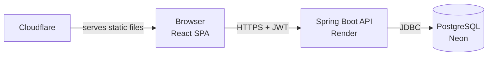

# Cinelog

[](https://github.com/kira-khern/cinelog/actions/workflows/ci.yml)


A social movie and series diary: rate what you watch, follow other people and see their reviews in a feed. A Spring Boot REST API with JWT authentication and a PostgreSQL database managed by Flyway, and a React single-page app, deployed on Render, Neon and Cloudflare.

**Status: work in progress.** Authentication, CI and deployment are done. Movie search, reviews and the feed are next – see the [Roadmap](#roadmap).

**Live demo:**  https://cinelog-cx3.pages.dev/
(The backend runs on Render's free tier and sleeps when idle, so the first request can take up to a minute.)


## Why this project exists

I built Cinelog after finishing the Codecool full-stack developer program, as a portfolio project I plan and build on my own. My earlier projects followed course assignments; here I wanted to practise the parts of a real project around the code as well: planning the work in a GitHub Project, small pull requests behind a CI gate, database migrations and a live deployment from the first weeks.

The project is built in vertical slices: each feature goes from the database to the browser before the next one starts, so the live app always works, even while it is unfinished.

## Features

**Done**
- Register, log in and log out
- Stay logged in across page reloads
- Protected pages that redirect to the login page when logged out
- Profile page for the current user

**Planned** (see [Roadmap](#roadmap))
- Search movies and series (TMDB)
- Rate and review titles with half-star ratings
- Follow users and read their reviews in a feed
- Likes, watchlist, weekly trending titles
- AI summary of what users think about a title

## Tech stack

| Layer | Technologies |
|---|---|
| Backend | Java 25, Spring Boot 4.1 (Web MVC, Data JPA, Security, OAuth2 Resource Server, Validation) |
| Database | PostgreSQL 17, Flyway migrations |
| Frontend | React 19, React Router 7, Vite 8, JavaScript, CSS Modules |
| Testing | JUnit, Spring Boot Test, MockMvc, Testcontainers |
| DevOps | Docker (multi-stage), Docker Compose, GitHub Actions |
| Hosting | Render (backend), Neon (database), Cloudflare (frontend) |

## How it works



The browser loads the React app from Cloudflare and calls the API on Render. After login the API returns a signed JWT; the frontend sends it in the `Authorization` header with every request, and the API checks the signature without storing any session.

## Project structure

The backend is organised by feature (see [Key decisions](#key-decisions)). The controller → service → repository layering still applies inside each package.

```
cinelog/
├── .github/workflows/ci.yml      # backend tests, frontend lint and build
├── docker-compose.yml            # local PostgreSQL
├── backend/
│   ├── Dockerfile                # multi-stage build
│   └── src/main/java/com/kira/backend/
│       ├── auth/                 # register, login, token response
│       ├── security/             # security config, JWT encoder/decoder, CORS
│       ├── user/                 # User entity, /api/users/me
│       ├── title/                # Title entity (local copy of TMDB data)
│       └── review/               # Review entity
│   └── src/main/resources/db/migration/   # Flyway SQL migrations
└── frontend/src/
    ├── api/                      # one API client for every request
    ├── auth/                     # AuthContext, ProtectedRoute
    ├── components/               # Layout, FormField
    └── pages/                    # Home, Login, Register, Profile
```

## Key decisions

### Code is organised by feature, not by layer
Packages are named after what the app does (`auth`, `user`, `title`, `review`) instead of `controller`, `service`, `repository`. Changing one feature touches one folder, and the folder names show what the app is about. The app will grow to around ten features; in a layer-based layout each layer folder would hold ten or more unrelated classes.

### The database schema is versioned with Flyway
Tables are created by SQL migrations (`V1__...sql`), not by Hibernate. On startup Hibernate only **validates** that the entities match the tables (`ddl-auto=validate`). A typo in a column name stops the app at startup instead of silently creating a second column. Once a migration has run it is never edited; every change is a new migration.

### Rules live in the database too
A user can review a title only once (unique constraint on `user_id, title_id`), and a rating must be between 1 and 10 (CHECK constraint). The API validates the same rules, but the database is the last line of defence.

### Ratings are whole numbers
Ratings are shown as 0.5–5 stars but stored as integers from 1 to 10 (7 = 3.5 stars). Integers avoid rounding problems with decimal numbers.

### Movies are cached locally, not copied in bulk
Movie data comes from TMDB. A title is saved to the `titles` table only when someone reviews it for the first time, identified by its TMDB id and media type (movies and series are numbered separately on TMDB). Only the poster's file path is stored; the frontend builds the image URL in the size it needs.

### JWT with Spring's built-in resource server
Instead of a hand-written JWT filter, the API uses Spring Security's OAuth2 Resource Server with an HMAC-SHA256 key. Login creates the token with a `JwtEncoder`; every other request is checked by the framework's `JwtDecoder`. The user's role is a claim in the token and is mapped to a Spring authority (`ROLE_USER`, `ROLE_ADMIN`).

### Login failures say nothing about which part was wrong
Unknown username and wrong password return the same `401 Invalid username or password`, so the login endpoint cannot be used to find out which usernames exist (user enumeration).

### Password length is capped at 72 characters
BCrypt only uses the first 72 bytes of a password and ignores the rest. The validation rule makes this limit visible instead of silently accepting longer passwords.

### Entities never leave the service layer
Endpoints return records such as `UserResponse`. The `User` entity holds the password hash; returning it directly would leak the hash in the JSON.

### Tests run against a real PostgreSQL
Integration tests use Testcontainers to start PostgreSQL 17 in Docker, run the Flyway migrations and send real HTTP requests through the full security chain with MockMvc. They test the same database engine and schema that production uses, not an in-memory substitute.

### Configuration comes from the environment, with local defaults
Database credentials, the JWT secret, the CORS origins and the port are environment variables. Each has a default for local development, so the app starts with no setup; production overrides all of them.

### A multi-stage Docker image
The first stage builds the jar with the JDK and Maven; the second stage contains only the JRE and the jar. The final image is smaller, contains no source code or build tools, and runs as a non-root user. The JVM is limited to 75% of the container's memory to fit the 512 MB free tier.

### No CORS in development, strict CORS in production
In development the Vite dev server proxies `/api` to the backend, so the browser sees one origin. In production the API only accepts requests from the origins listed in `CORS_ALLOWED_ORIGINS`.

## Getting started

### Prerequisites
- JDK 25
- Node.js 20.19+ or 22.12+ (required by Vite 8)
- Docker Desktop (for the local database and the tests)

### 1. Start the database

```bash
git clone https://github.com/kira-khern/cinelog.git
cd cinelog
cp .env.example .env          # PowerShell: Copy-Item .env.example .env
docker compose up -d
```

PostgreSQL runs on port **5433**, so it does not clash with a local PostgreSQL install.

### 2. Start the backend

```bash
cd backend
./mvnw spring-boot:run        # Windows: .\mvnw.cmd spring-boot:run
```

No environment variables are needed locally: the defaults match `docker-compose.yml`. Flyway creates the tables on the first start. The API runs on http://localhost:8080.

### 3. Start the frontend

In a second terminal:

```bash
cd frontend
npm install
npm run dev
```

Open http://localhost:5173.

### Environment variables

| Variable | Purpose | Local default |
|---|---|---|
| `DB_URL` | JDBC connection URL | `jdbc:postgresql://localhost:5433/cinelog` |
| `DB_USERNAME` | Database user | `cinelog` |
| `DB_PASSWORD` | Database password | `cinelog_dev` |
| `JWT_SECRET` | HMAC key for signing tokens, at least 32 characters | a development-only value – **always set it in production** |
| `CORS_ALLOWED_ORIGINS` | Comma-separated origins allowed to call the API | `http://localhost:5173` |
| `PORT` | HTTP port | `8080` |
| `VITE_API_URL` | Frontend build only: the API's base URL | empty (the dev proxy is used) |

## API

Every endpoint except `/api/auth/**` requires an `Authorization: Bearer <token>` header. A missing or invalid token returns `401`.

| Method | Endpoint | Access | Description |
|---|---|---|---|
| POST | `/api/auth/register` | Public | Create a user. `201`, `400` for invalid input, `409` if the username or email is taken |
| POST | `/api/auth/login` | Public | Returns `{ "accessToken", "tokenType", "expiresIn" }`. `200`, or `401` on bad credentials |
| GET | `/api/users/me` | User | The logged-in user's profile |

## Running the tests

```bash
cd backend
./mvnw verify                 # Windows: .\mvnw.cmd verify
```

Docker must be running, because the tests start their own PostgreSQL container. The suite covers registration (success, taken username, invalid email), login (valid and wrong password) and the protected `/api/users/me` endpoint (no token, valid token, invalid token).

GitHub Actions runs the backend tests and the frontend lint and build on every pull request. The `main` branch is protected: it only accepts pull requests whose checks pass.

## Deployment

| Part | Service | Notes |
|---|---|---|
| Frontend | Cloudflare | Rebuilt on every push to `main`; `VITE_API_URL` is set at build time |
| Backend | Render (Docker) | Built from `backend/Dockerfile` on every push to `main` that changes `backend/` |
| Database | Neon (PostgreSQL 17, Frankfurt) | Same region as the backend; migrations run on startup |

## What I would improve next

### Known issues

- Error responses still use Spring's default error format; a consistent `ProblemDetail` format is planned.
- The frontend does not log out automatically when the token expires after one hour; the next request simply fails.
- The JWT is stored in `localStorage`. It is simple for a separate SPA, but readable by any script on the page; an HttpOnly cookie would be safer against XSS.
- Usernames are case-sensitive (`Kira` and `kira` are different users), while emails are stored in lower case.
- If two people register the same username at the same moment, the database constraint stops the second one, but the API answers `500` instead of `409`.
- The styling is temporary until the final design is done.

### First fixes
1. Global error handling with `ProblemDetail`, which also turns the duplicate-registration `500` into a `409`.
2. Case-insensitive usernames.
3. Automatic logout on the frontend when the token expires.

## Roadmap

- [x] Repository setup, local database with Docker Compose
- [x] Database schema and JPA entities
- [x] CI for backend and frontend
- [x] Registration and JWT login
- [x] React frontend with login, registration and protected routes
- [x] Deployment
- [ ] Global error handling with `ProblemDetail`
- [ ] Search movies and series via TMDB
- [ ] Reviews, title page with average rating
- [ ] Follow users, feed with cursor pagination
- [ ] Likes and watchlist
- [ ] AI summary of reviews for a title
- [ ] Weekly trending titles with a scheduled job
- [ ] OpenAPI / Swagger UI
- [ ] Final design

Progress is tracked on the [project board](https://github.com/users/kira-khern/projects/1) 

## How this was built

I planned and built Cinelog on my own after the Codecool program. I used Claude as a mentor: to discuss design options, explain concepts and help with debugging. I made the decisions, wrote and tested the code, and reviewed every suggestion before using it.

## Author

Built by Kíra ([@kira-khern](https://github.com/kira-khern)).
